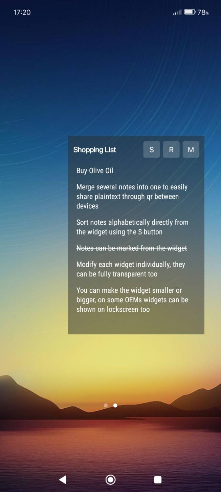
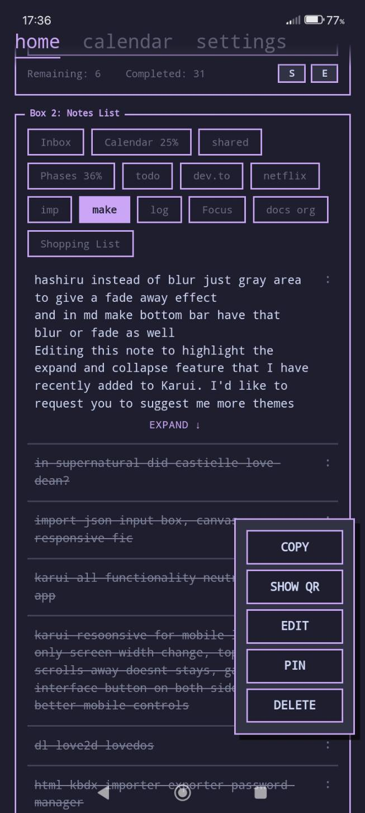
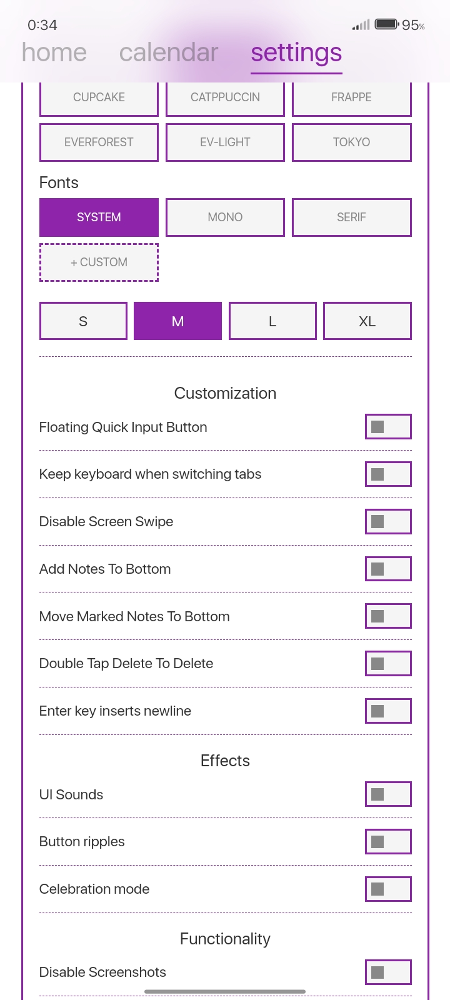
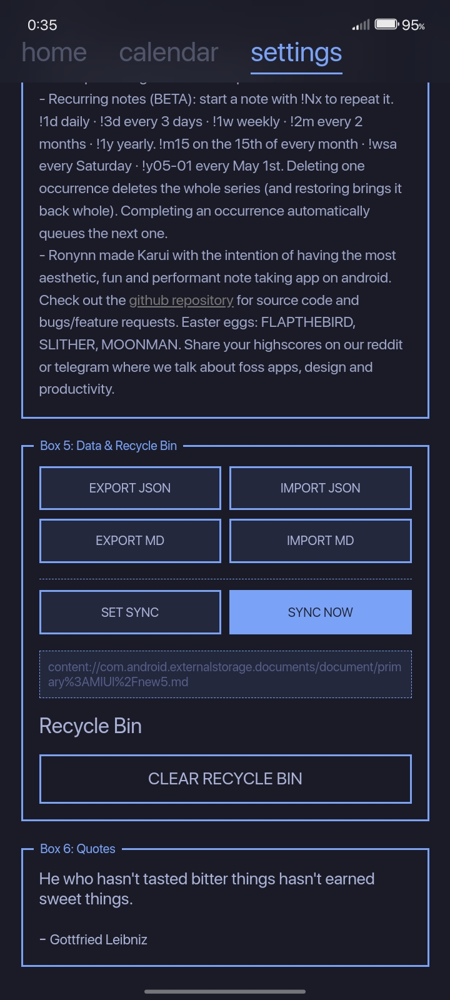
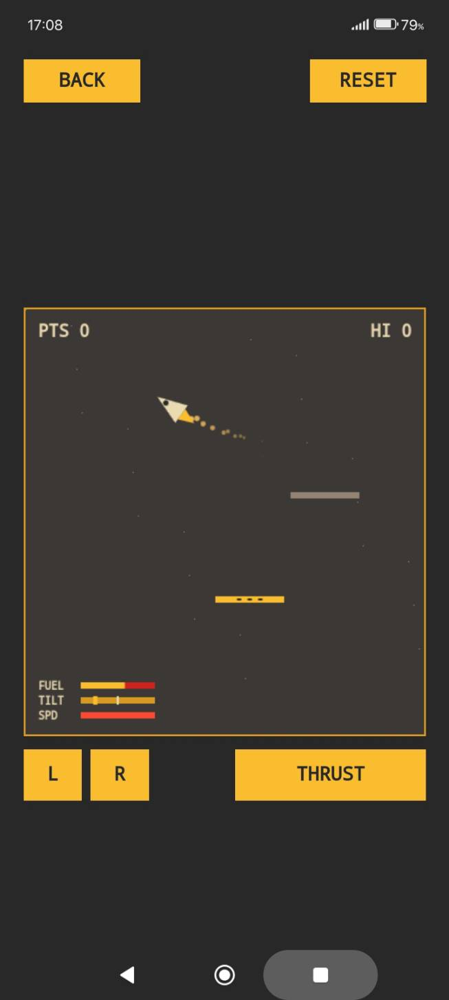

# Colby's Todo App

  

An open-source, privacy-focused, lightweight Android to-do list and note-taking application inspired by retro design, Windows Mobile, and the System-24 aesthetic.

The application works offline and supports Markdown-based synchronization, home screen widgets, customizable themes, reminders, and productivity tools.

## Contact

- **Name:** Colby Lee Bean
- **Email:** beancolby257@gmail.com
- **GitHub:** https://github.com/BeanColby44
- **LinkedIn:** https://www.linkedin.com/in/colby-bean-922179449/

## Technology Stack

- Vue.js
- Java
- Android
- JavaScript
- HTML and CSS
- Markdown
- Native Android Components

## Screenshots

  
  
  
  
  

## Use Cases

- Daily note-taking and task management
- Shopping lists and personal reminders
- Habit tracking and productivity monitoring
- Journaling and daily activity logs
- Capturing ideas from other applications
- Creating bucket lists and personal goals
- Managing multiple note categories
- Sharing notes through QR codes
- Playing built-in mini-games

## Features

### Task and Note Management

- Create, edit, organize, and delete notes.
- Manage tasks through customizable tabs.
- Track completed tasks with percentage indicators.
- Sort notes using drag-and-drop functionality.
- Recover deleted notes using the recycle bin.
- Access notes directly from home screen widgets.
- Create notes through the Android status bar.

### Customization

- Retro-inspired user interface.
- Multiple built-in themes.
- Custom font support using TTF files.
- Customizable note tabs.
- Optional UI sound effects.
- Button ripple effects and celebration animations.
- Optional screenshot protection for privacy.

### Offline Functionality

- Operates without internet access.
- Stores notes locally.
- Supports Markdown file synchronization through external tools.
- Allows notes to be edited using compatible text editors.
- Uses lightweight native Android components.

### Productivity Tools

- Calendar integration within the application.
- Reminder and recurring-task syntax.
- Task completion percentage tracking.
- QR code sharing and importing.
- Note merging and organization.
- Word and character counting.

### Mini-Games

Includes optional retro-inspired mini-games:

- Flappy Bird
- Snake
- Moon Lander

## Technical Architecture

### Frontend

- Vue.js for interactive UI components.
- HTML and CSS for responsive layouts.
- JavaScript for application behavior.
- Retro-inspired visual design.

### Android Integration

- Java-based native Android functionality.
- Home screen widgets.
- Status bar input functionality.
- Local file access.
- Android notification and reminder support.

### Data Storage

- Local Markdown files.
- Offline-first architecture.
- File-based synchronization.
- No mandatory cloud storage.

## Design Principles

### Privacy First

The application is designed to operate locally without requiring an internet connection.

### Lightweight Performance

The architecture emphasizes minimal resource consumption and avoids unnecessary dependencies.

### Customizable Experience

Users can customize themes, fonts, tabs, and interface preferences.

### Offline Productivity

Core task-management features remain available without network access.

## Version 2.2 Update Notes

### Performance Improvements

- Improved application loading performance.
- Optimized landscape layouts.
- Improved note and tab menu positioning.
- Reduced unnecessary visual effects.
- Optimized tab transition animations.
- Separated calendar CSS from component logic.
- Added lazy loading for optional animations.
- Improved game loading behavior.

### New Features

- Expanded widget font support.
- Improved widget interface.
- Expandable and collapsible notes.
- Beta reminder and recurring-task syntax.
- QR code sharing and importing.
- Word and character counting.
- Note merging functionality.
- Improved note organization.

## Roadmap

- [x] Custom font selection
- [x] Home screen widgets
- [x] Markdown-based note storage
- [x] QR code generation
- [x] Integration with external Markdown editors
- [ ] Multilingual support
- [ ] Camera-based QR code scanning
- [ ] Additional reminder scheduling options
- [ ] Experimental local synchronization methods
- [ ] Audio-based note sharing experiments

## Development Notes

The application architecture emphasizes lightweight components, offline functionality, customizable interfaces, and local data management.

Earlier versions used Alpine.js, Svelte, and vanilla JavaScript. The project documentation describes a later Vue.js-based implementation.

## License

The original Karui project documentation identifies GPLv3 as its license. Any redistribution or modification must comply with the applicable license and preserve required copyright and attribution notices.

## Contact and Feedback

For professional inquiries, technical discussions, or collaboration:

**Colby Lee Bean**

- Email: beancolby257@gmail.com
- GitHub: https://github.com/BeanColby44
- LinkedIn: https://www.linkedin.com/in/colby-bean-922179449/

---

*Documentation customized for Colby Lee Bean. Original project authorship is not established by this README.*